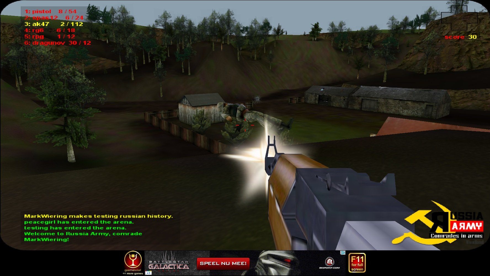
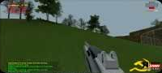
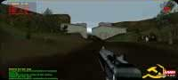
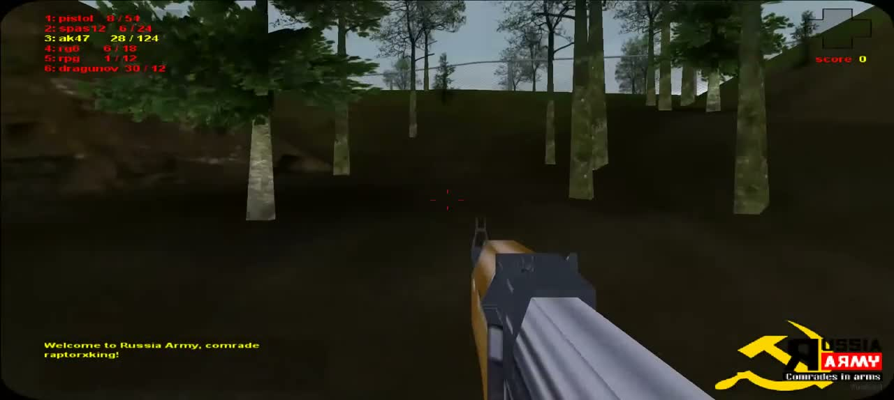
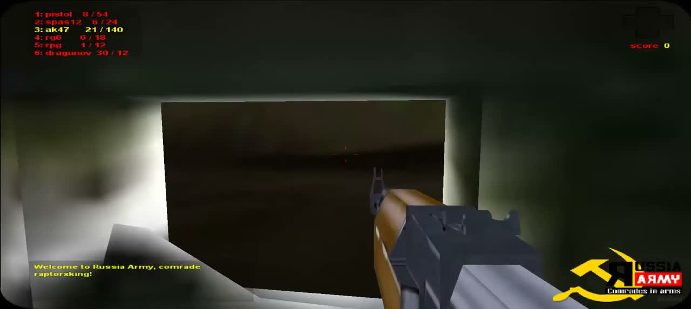
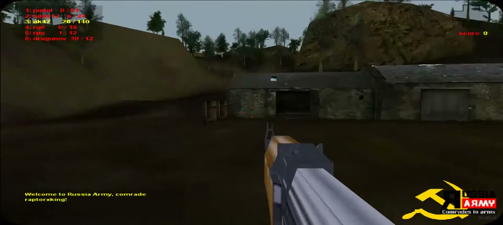
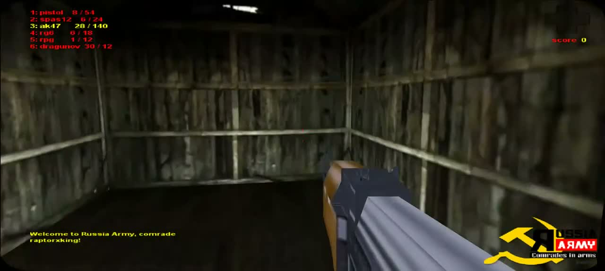
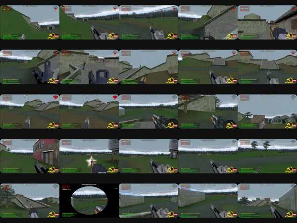
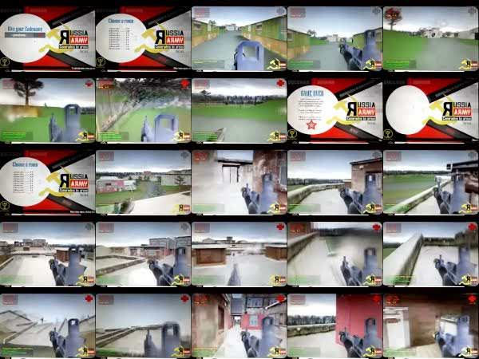
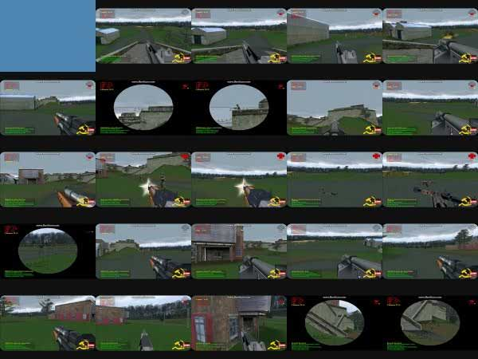

# Rendered comparison board — 2026-09-30

Current AK temporal evidence (2026-10-06): [native frames and current motion trace](../artifacts/fidelity-review/2026-10-06/source-screen-diagnostics/ak-temporal/comparison.html) provide independent sliders for the preserved reload sequence and actual current callback samples. Current visuals are clipped geometry bounds, not textured captures. [Validation and limitations](../artifacts/fidelity-review/2026-10-06/source-screen-diagnostics/ak-temporal/REPORT.md) document the recovered literal coefficient correction; native camera/clock registration and audio remain unproved.

This board preserves successive implementation stages. The opening comparison pairs and notes describe the historical authored stage; the recovered-source sections below supersede its geometry, scoring, health, scope and audio limitations. Image paths were refreshed during later passes, so adjacent historical prose does not establish the current implementation.

Latest Woodlands interior evidence (2026-10-06): the standalone [window/corridor comparison](../artifacts/fidelity-review/2026-10-06/cliffview-window-corridor/comparison.html) shows current four-/eight-light window panels and a receding plank floor beside unchanged W1 reference tiles. [Independent review](../artifacts/fidelity-review/2026-10-06/cliffview-window-corridor/VISUAL_REVIEW.md) accepts V12's broad plain weathered-room character. Camera registration and exact native raster remain unproved.

Latest per-map horizon evidence (2026-10-06): the [sky/distance comparison](../artifacts/fidelity-review/2026-10-06/source-draw-distance/comparison.html) shows the fixed far-plane clipping before/after and both maps beside their preserved references. [Independent review](../artifacts/fidelity-review/2026-10-06/source-draw-distance/VISUAL_REVIEW.md) accepts V07's broad sky/horizon/visibility. Exact historical sampling remains qualified.

Current soldier appearance (2026-10-06): [front/rear comparison on both maps](../artifacts/fidelity-review/2026-10-06/soldier-current-capture/comparison.html) pairs actual current recovered GI rendering with its untouched original atlas. [Independent review](../artifacts/fidelity-review/2026-10-06/soldier-current-capture/VISUAL_REVIEW.md) accepts V26's source-evidenced model appearance. The atlas is extracted source artwork, not a close native-runtime screenshot; exact material/animation/camera equivalence remains qualified.

## Historical authored comparison stage

The images are real Chromium captures of the source build at the recorded comparison stages. Scene/menu/HUD views use 1440 × 900; the RG6, SPAS12 and Dragunov pairs use 1280 × 576, matching the native 200 × 90 Woodland storyboard aspect ratio. Map/HUD views use low quality; soldier views include both low and high quality. Originals are source evidence, not project assets. These pairs compare large colors, forms and screen composition; the new camera stations are authored, and are **not registered original camera transforms**. Recording camera transforms remain unmeasured. Source model coordinates and vertical FOV50 were subsequently recovered; see the later source sections.

| Focus | Original reference | Updated copy |
| --- | --- | --- |
| Woodland HUD and AK |  |  |
| Woodland HUD at the wide video aspect ratio | [Original 20-second frame](research-evidence/2026-09-30/woodland-video-20s.jpg) | [1280 × 576 HUD](../artifacts/fidelity-review/2026-09-30/current/woodlands-hud-wide.png) |
| Woodland AK muzzle styling | [Pale source burst](research-evidence/2026-09-30/woodland-mark-wiering.jpg) | [Low-quality flash](../artifacts/fidelity-review/2026-09-30/current/woodlands-ak47-flash-low.png) · [High-quality flash](../artifacts/fidelity-review/2026-09-30/current/woodlands-ak47-flash-high.png) |
| Woodland RG6 |  | [Low quality](../artifacts/fidelity-review/2026-09-30/current/woodlands-rg6-low.png) · [High quality](../artifacts/fidelity-review/2026-09-30/current/woodlands-rg6-high.png) |
| Woodland SPAS12 |  | [Low quality](../artifacts/fidelity-review/2026-09-30/current/woodlands-spas12-low.png) · [High quality](../artifacts/fidelity-review/2026-09-30/current/woodlands-spas12-high.png) |
| Woodland unscoped Dragunov |  | [Low quality](../artifacts/fidelity-review/2026-09-30/current/woodlands-dragunov-low.png) · [High quality](../artifacts/fidelity-review/2026-09-30/current/woodlands-dragunov-high.png); legacy coarse silhouette is revised; fine geometry and animation remain unresolved. |
| Woodland hills and vegetation |  |  |
| Woodland mixed crowns and ridge wires | Same 35-second source above shows leafy crowns, fine sparse branches and thin horizontal boundary wires. | [Low-quality forest](../artifacts/fidelity-review/2026-09-30/current/woodlands-forest.png) · [High-quality forest](../artifacts/fidelity-review/2026-09-30/current/woodlands-forest-high.png) |
| Woodland room character |  |  |
| Woodland stone outbuilding |  |  |
| Woodland outbuilding at high quality | Same 15-second source above supports the low yard and tall exposed bank. | [High-quality outbuilding](../artifacts/fidelity-review/2026-09-30/current/woodlands-outbuilding-high.png) |
| Woodland compact HUD | The desktop source establishes margins, not an original mobile interface. | [Compact layout with chat clear of the emblem](../artifacts/fidelity-review/2026-09-30/current/woodlands-hud-compact.png) |
| Woodland shed-yard fencing |  |  |
| Woodland timber room |  |  |
| Woodland soldier at low quality |  |  |
| Woodland soldier at high quality | Same full-size still above; pose differs. |  |
| Barrack roof/ramp composition |  |  |
| Barrack pink/red facade regions |  | [Low-quality pink facade](../artifacts/fidelity-review/2026-09-30/current/barrack-pink-facade.png) · [High-quality pink facade](../artifacts/fidelity-review/2026-09-30/current/barrack-pink-facade-high.png) |
| Barrack brick and tall red window surrounds |  | [Low-quality courtyard](../artifacts/fidelity-review/2026-09-30/current/barrack-courtyard.png) · [High-quality courtyard](../artifacts/fidelity-review/2026-09-30/current/barrack-courtyard-high.png) |
| Barrack scope |  |  |
| Barrack results |  |  |
| Death presentation | Original immediate-death state remains unresolved. |  |
| AK equip/refill motion |  | [Lowered](../artifacts/fidelity-review/2026-09-30/current/woodlands-ak-equip-0.png) · [Halfway](../artifacts/fidelity-review/2026-09-30/current/woodlands-ak-equip-0.5.png) · [Ready](../artifacts/fidelity-review/2026-09-30/current/woodlands-ak-equip-1.png) |
| Room-selection staging |  |  |
| Working room directory | Same successive-screen source above; exact historical labels are unresolved. |  |
| Menu composition |  |  |

The capture pass establishes that the implemented maps, UI and shader run and can be inspected. It does not prove a recovered historical layout. Woodlands' dark earth, stone/plaster/timber family, thin branch foliage and broad angular AK are closer to the sharp source than the winter baseline. The first rendering pass still had pale boulder piles, dark brick and circular leaf crowns; those images are retained in [before-sharp-reference](../artifacts/fidelity-review/2026-09-30/before-sharp-reference).

The fresh HUD and map images include the Woodland crosshair, viewport-corner, sky and initial timber-shed refinements. The source now uses red outer crosshair strokes without a center dot, rounded black gameplay corners, and subdued gray-blue sky in place of the earlier prominent cloud band. Timber-shed wall rails and diagonal braces follow the [original 11-second interior frame](research-evidence/2026-09-30/woodland-video-11s.jpg). The `shed` camera was captured and inspected. Refreshed shed and outbuilding captures include lighter weathered plank walls, separate dark floors, plain timber side walls and the long low stone facade. Mottled pale bark replaces the flat trunk material. The open bay, closed doors and gray roof are visible; their proportions and positions remain authored. The cottage view above is separate from the shed framing.

At this historical stage, remaining discrepancies included the actual building/route inventory and positions, full soldier kit/animation, pistol/RPG projections, remaining SPAS12/Dragunov details and per-slot animations, unseen RG6 states, exact original scope reticle and death states, audio, and measured gameplay values. At this stage the outline health cross was verified in Woodland footage, but damage-fill behavior and the source score formula were not established. Later source integrations install recovered health art/fill and kill30/pickup5 scoring.

See [all forty checklist dispositions](FIDELITY_PROGRESS.md) and [sharp-source provenance and observations](research-evidence/2026-09-30/REFERENCE_OBSERVATIONS.md). No full original executable was run. The source video excerpt is silent.

The first low/high legacy soldier captures exposed a carrier visibility defect: pale torso fabric occluded the dark front vest. The legacy-only carrier was moved ahead of the cloth surface; refreshed low/high captures now show the dark vest clearly and both browser cases pass. Hidden kit, exact helmet shape and original animation remain unmeasured.

The shed-yard capture uses the terrain-aware review hook at x=-31, z=39, yaw=0, pitch=.05 after freezing the shed reference view. Timber panels and the open approach were inspected; fence positions remain authored.

The authored emblem now has a broad horizontal gold sweep behind its wordmark and no added logo star. Scope/results captures expose the retained custom reticle and authored match statistics; those details are not established as original. The result/death review hooks call actual client state handlers under E2E mode, then freeze presentation. They do not measure historical match rules.

Legacy AK equip uses a roughly 0.9-second lowering/rise presentation; refill rises over 0.8 seconds after the actual ammo update. The magazine stays attached. Presentation samples freeze the spawn counters while checking motion; the separate [actual authoritative reload capture](../artifacts/fidelity-review/2026-09-30/current/woodlands-ak-authoritative-refill.png) shows Woodland refilled to 28 with the corresponding reserve deduction. See [continuous-frame observations](research-evidence/2026-09-30/ANIMATION_OBSERVATIONS.md); original lockout/input timing remains unmeasured.

The online menu now presents name/map entry first and room selection second. Back retains the entered name/map; joining occurs only on the explicit Join button. Empty name validation stays on the first stage, and a server rejection stays on the room stage. These state transitions pass real browser checks. Exact historical room labels, typography and server topology remain unresolved.

The refreshed forest/outbuilding pairs include a deterministic mix of dense leafy and sparse fine-branched crowns. Woodland boundary fencing now uses two dark horizontal terrain-following strands, replacing the conspicuous pale diamond mesh; Barrack keeps its prior fence treatment. The 35-second source supports these broad silhouette changes. Tree assignments, wire heights and positions remain authored. Both quality tiers were rendered and inspected with no browser errors; shared trunk positions and collision were preserved.

The RG6 pair follows the [directly decoded selected-weapon frame](research-evidence/2026-09-30/RG6_OBSERVATIONS.md). Legacy now presents a broad faceted gray tube/collar above flat support/body faces, with lighter upper planes and darker sides. Its hip position moves the front toward the source's upper/right screen footprint. Earlier copy views exposed a dark drum, hands and tall fork sight absent from this visible source portion; those features are suppressed in Legacy. Exact hidden geometry, FOV and other RG6 states remain unresolved, and the different source/current viewport ratios prevent treating normalized placement as exact camera registration.

The stone-building pair now includes an authored low approach yard and taller exposed bank behind the right roof. Its [shape observations and limits](research-evidence/2026-09-30/BANK_OBSERVATIONS.md) record the source and calibration. The review camera is centred on the bay; darker inward wall faces keep the interior readable, and a mottled stone material replaces stretched fine soil grain on the bank. Physical ground follows the same shared heightfield as client movement and server combat. Bank dimensions, building count/placement, roof details and exact original topology remain unresolved.

Both sharp Woodland sources put weapon/chat text about 5% from the left. The copy now follows that inset, with the weapon block about 3.5% from the top. The compact capture verifies that weapon rows stay clear of health and chat wraps before the corner emblem; this is responsive copy behavior, not a claim about an original mobile edition.

Barrack's updated exterior mix follows the [facade observations](research-evidence/2026-09-30/BARRACK_FACADE_OBSERVATIONS.md): tall pink/red surrounds now reach above window heads, and one selected building has broad pink wall planes. Brick remains visible on other walls. Upright divided panes use pale blue-gray glass; inside/outside window placement agrees. The source boards support the large colour families and window proportions, not exact building assignment, window count, pigment or lighting. The new comparison station is authored and leaves the existing shared solids/routes unchanged.

Woodland's flattened stone-building yard now receives a local earth surface weight rather than reverting to green grass solely because its slope is low. The steep bank uses a separate coarse angular brown/gray texture projected across its visible face. Ordinary ground keeps its horizontal soil/grass texture; the bank's heightfield and collision remain unchanged. These patterns are authored from the source surface family, not extracted original textures.

The latest menu/desktop/compact HUD and low/high soldier captures include the intersecting menu wedges and enlarged corner wordmark: black upper name, white ARMY on red and white tagline. Broad composition is accepted against the source; exact artwork remains authored. The RG6 pair now includes the current wordmark. Refreshed AK motion captures also include the current wordmark and varied crowns. Recovered [native later-weapon crops](research-evidence/2026-09-30/REMAINING_WEAPON_OBSERVATIONS.md) now establish SPAS12 selected row 2 and Dragunov selected row 6, plus scope mask/HUD composition. They do not establish fine details or firing/reload timing.

The revised SPAS12 comparison replaces the exposed modern stock/grip/hands with a broad pale-gray tray and receiver, dark upper barrel and two smaller gray rounded surrounds. These shapes follow the native source crops; the exact screen footprint and unseen mechanisms remain unresolved. The scope capture now omits the corner emblem while preserving a real sent chat line, weapon rows and health. Its custom reticle remains unchanged because the source cannot resolve it.

The weapon follow-up uses the native storyboard aspect ratio before comparing projections. Legacy SPAS12 sits farther from the camera and lower, reducing its oversized rear face. Legacy Dragunov now has a slim dark elongated optic/barrel and subdued gray lower faces; visible sleeves, bright cyan lens and prominent wooden furniture are suppressed. Modern presentation and gameplay are retained. The narrow-screen emblem font override now applies by width rather than desktop height, keeping the full wordmark proportion at the wide source aspect ratio while preserving the compact phone layout.

The shed wall material now receives broad irregular neutral-gray vertical weathering, with quieter joints; the finer dark floor map is retained separately. An independent texture seed preserves tree placement. Low/high shed captures are included with the landscape pairs; precise original room proportions and roof/bay topology remain open. The stone outbuilding now has source-supported asymmetric bay/door roof sections. Historical dimensions, placement and rear topology remain unknown.

The [asymmetric outbuilding correction](research-evidence/2026-09-30/OUTBUILDING_OBSERVATIONS.md) puts the dark front bay in a shorter left section, splits the roof, places one broad and one narrow closed door on the right, and removes the projecting pale canopy and unsupported side panes. A tiny pale rooflight follows the sharp sources. The rear is closed as an authored fit for the dark bay, with actual client entry/stop/return verified; historical rear topology remains unknown. A new [elevated yard station](../artifacts/fidelity-review/2026-09-30/current/woodlands-outbuilding-yard.png) and [high-quality pair](../artifacts/fidelity-review/2026-09-30/current/woodlands-outbuilding-yard-high.png) expose both roof sections; this is an authored review camera, not an original coordinate measurement.

The crown/material follow-up preserves the shared tree positions and trunk matrices while varying Woodland crown proportions and angles through an independent indexed profile. Some dense crowns are wider/lower, mixed with taller and sparse branch crowns. The stone-building pitched roof now has mottled neutral-gray weathering rather than a uniform green-gray plane. Original crown identities, opacity distribution and exact roof texture remain unresolved. The subsequent mechanics correction implements the [observed AK refill endpoint of 28](research-evidence/2026-09-30/AMMO_COUNTER_OBSERVATIONS.md) in client and server for Woodland; spawn/reset 30/150 remains an explicit copy rule.

The latest bank comparison reduces the repeated outlined-pebble mosaic in favor of broader overlapping slab patches, partial fractures and softened earth transitions. It follows the surface family in the sharp 15-second frame without claiming an extracted original texture. Earlier animation snapshots precede the final metal separation. The native-aspect [AK low](../artifacts/fidelity-review/2026-09-30/current/woodlands-ak47-low.png) and [AK high](../artifacts/fidelity-review/2026-09-30/current/woodlands-ak47-high.png) captures distinguish the pale foreground metal extension from the dark receiver, matching the source's broad value separation; dimensions and modern geometry remain unchanged.

The latest foliage/wall pass changes only Woodland surface maps: dense leafy cards have asymmetric, flatter overlapping leaf masses with subdued branch ribs; sparse crowns retain their existing branch artwork. Weathered stone walls now show broader broken gray/green masonry patches at a consistent authored world scale. Existing trees, crown transforms, collision and building geometry remain unchanged. The shed-yard comparison is refreshed and now shows the current terrain-following strands rather than the stale diamond-mesh perimeter. Exact original opacity, distribution and textures remain open.

The Woodland HUD typography pass scales the six weapon rows to roughly 15% of viewport height, with heavier proportional chat text. Desktop (1440 × 900), wide video aspect (1280 × 576), and compact (390 × 844) captures were inspected; the compact weapon rows remain clear of health and chat stays clear of the emblem. These broad proportions follow the sharp sources, but the exact original font is unresolved. Earlier HUD and soldier images are preserved in [before-hud-hands](../artifacts/fidelity-review/2026-09-30/before-hud-hands).

Both current soldier tiers show exposed tan hands using the same skin tint as the face, following the visible hand beside the vest in the sharp Woodland still. The pose differs, and the hidden kit, original skin shader, exact uniform and animation remain unresolved. The desktop/wide/compact HUD and low/high soldier browser checks pass without page or console errors.

The Legacy AK front sight now has thin upright tips above a crossbar and splayed lower supports, matching the visible silhouette in the sharp still and the 20-second frame. Refreshed native-aspect [low](../artifacts/fidelity-review/2026-09-30/current/woodlands-ak47-low.png) and [high](../artifacts/fidelity-review/2026-09-30/current/woodlands-ak47-high.png) images were inspected. Earlier images are retained in [before-ak-sight](../artifacts/fidelity-review/2026-09-30/before-ak-sight). The dimensions and hidden depth are authored; this does not settle the whole gun projection, firing states or other slots.

The sparse-crown pass replaces regular ladder fans with finer, irregular curved branches and uneven leaf wisps. Low/high forest views were inspected against the 35-second source. The shared trunks, collision, crown assignments and transforms are unchanged; original texture alpha, tree identities and density remain unknown. The current AK rear-notch ears now taper and lean forward, following the small angular forms in the sharp still and 20-second frame; camera pose and Modern geometry remain unchanged. Earlier captures are preserved in [before-sparse-crowns-projection](../artifacts/fidelity-review/2026-09-30/before-sparse-crowns-projection).

Legacy first-person muzzle styling now uses authored pale soft rays in place of the saturated orange flame asset. The Woodland AK burst is also enlarged toward the broad flash in the sharp still; other slots retain their existing scale. The comparison capture freezes a presentation pulse through an E2E-only hook, and does not measure actual shot timing. Exact original flash footprint, duration, lighting and other weapon effects remain unresolved.

The lifecycle correction follows the [contemporaneous death/re-entry evidence](research-evidence/2026-09-30/LIFECYCLE_CONTROL_FINDINGS.md). Actual lethal self-blasts in both maps and both modes now show GAME OVER, with no automatic player respawn. The online client leaves only after rendering its results; a real observer remains alive in a playing room. Replay returns to name/map entry before a fresh life. [Barrack solo](../artifacts/fidelity-review/2026-09-30/current/barrack-solo-game-over.png), [Barrack online](../artifacts/fidelity-review/2026-09-30/current/barrack-online-game-over.png), [Woodland solo](../artifacts/fidelity-review/2026-09-30/current/woodlands-solo-game-over.png) and [Woodland online](../artifacts/fidelity-review/2026-09-30/current/woodlands-online-game-over.png) captures expose the actual transitions. Wide short desktop viewports retain the menu/result wordmark and circular panel; the prior shared short-height rule incorrectly hid the right-hand artwork. Exact original text, scoring, disconnect timing and room-wide limits remain unresolved.

The new [portal and publisher evidence](research-evidence/2026-09-30/PORTAL_PRESERVATION_OBSERVATIONS.md) adds an edition-labelled Woodland building-cluster view and a standing Barrack soldier. Historical publisher pages and a generic Director loader were recovered read-only. The loader is not the game payload, and no executable was run. These artifacts improve the reference inventory without proving map coordinates, model topology or audio.

Historical [Barrack and Woodland publisher payloads](research-evidence/2026-09-30/PAYLOAD_VARIANT_OBSERVATIONS.md) were subsequently recovered from archived `/applets/` paths. These are preserved source files, not rendered comparisons: [read-only extraction](research-evidence/2026-09-30/director-extraction/DIRECTOR_EXTRACTION_OBSERVATIONS.md) now supplies named JPEG/bitmap media, while [static scripts](research-evidence/2026-09-30/DIRECTOR_SCRIPT_OBSERVATIONS.md) expose mechanics and UI handlers. Their 3D geometry/UVs remain undecoded. The earlier generic-loader-only limitation is superseded for payload recovery, while exact asset/version comparisons remain open.

The latest [Woodland online spawn](../artifacts/fidelity-review/2026-09-30/current/woodlands-online-source-loadout.png) shows recovered ammunition **8/54, 6/24, 28/140, 6/18, 1/12, 30/12** with RG6 selected. All four map/mode startup captures pass against those values. The [M feedback capture](../artifacts/fidelity-review/2026-09-30/current/woodlands-current-members.png) now displays **Members: ALPHA BRAVO** in the log, following both recovered original `goody.keywalk` handlers. The earlier central roster panel is removed. Source texture/HUD exports have been inspected but have not yet replaced authored game artwork; original 3D models and their atlas coordinates remain undecoded.

The source health/control/reload followup uses the original64×64 Woodland health bitmaps with source-derived bottom-up red reveal and +1 display offset. [Damaged health](../artifacts/fidelity-review/2026-09-30/current/woodlands-original-health-damaged.png) and [compact health](../artifacts/fidelity-review/2026-09-30/current/woodlands-original-health-compact.png) expose the square aspect and HUD clearance after actual self-damage. [Barrack steering](../artifacts/fidelity-review/2026-09-30/current/barrack-arrow-steering.json) and [Woodland steering](../artifacts/fidelity-review/2026-09-30/current/woodlands-arrow-steering.json) record actual yaw change without lateral displacement. Real online reloads in [Barrack](../artifacts/fidelity-review/2026-09-30/current/barrack-immediate-reload.json) and [Woodland](../artifacts/fidelity-review/2026-09-30/current/woodlands-immediate-reload.json) verify immediate ammo transfer with a separate shooting lock. The refreshed [authoritative AK refill](../artifacts/fidelity-review/2026-09-30/current/woodlands-ak-authoritative-refill.png) starts its rise on accepted reload; its browser case and scope/death/replay both pass. The lockout follows recovered nominal frame counts, not measured original wall-clock duration.

[Full original mesh decoding](research-evidence/2026-09-30/W3D_METADATA_OBSERVATIONS.md) supersedes the earlier undecoded-geometry limitation: both original levels, all six guns, projectiles/flashes and the static GI mesh now have validated positions, UVs and faces. These files are preserved research artifacts; current screenshots still show authored scenery/weapons. Original GI skeleton record layout, runtime materials and coordinate/physics integration remain under investigation.

The [source scene integration foundation](research-evidence/2026-09-30/ORIGINAL_SCENE_INTEGRATION.md) now packages the original scene parts/textures and shares evaluated source transforms between a Three mesh builder and triangle queries. The [new rig audit](research-evidence/2026-09-30/W3D_RIG_AUDIT.md) recovers a numerically checked skinned GI and motion clip. These are still integration inputs rather than accepted rendered replacements; current scene captures retain the authored layout.

## Recovered scenery now active

The recovered source maps now replace the authored default blockouts in solo and online gameplay. [Barrack online](../artifacts/fidelity-review/2026-09-30/current/barrack-online-original-scene.png) and [Woodland online](../artifacts/fidelity-review/2026-09-30/current/woodlands-online-original-scene.png) show the original geometry, photographic texture images and model placements. Their adjacent JSON evidence records source triangle counts, normalization and authoritative positions. The earlier captures are preserved in `before-original-maps`.

Reviewed source views include the [Woodland stone barn](../artifacts/fidelity-review/2026-09-30/current/woodlands-outbuilding.png), [cottage](../artifacts/fidelity-review/2026-09-30/current/woodlands-cottage.png), [shed corner](../artifacts/fidelity-review/2026-09-30/current/woodlands-shed.png) and [Barrack roof approach](../artifacts/fidelity-review/2026-09-30/current/barrack-roof.png). All fourteen stations now use source spawns or model-derived positions with FOV50. They remain review cameras rather than recovered footage camera coordinates. The recovered editions are Barrack2011 and Woodland2015; exact equality with the 2010/2012/2014 recordings is unproved.

[Integration limits](research-evidence/2026-09-30/ORIGINAL_SCENE_INTEGRATION.md) cover whole-map planar floor projection, source apparent-size texture scales, practical unlit material handling and uniform player-height normalization. The current foreground guns and default-map soldiers now use recovered source meshes/textures. The GI skin and source animation replace authored equipment and poses. All13 Barrack door tracks run with movement removal, animated shot visibility, server state and recovered sound. Complete route tracing and full original rendering/physics parity remain open.

The final six source-map gameplay checks now pass in both modes and at low/high online quality, with no authoritative corrections. The source-derived Barrack ramp traverses completely in actual Game and server tests. [High Woodland](../artifacts/fidelity-review/2026-09-30/current/woodlands-online-high-original-scene.png) and [high Barrack](../artifacts/fidelity-review/2026-09-30/current/barrack-online-high-original-scene.png) were inspected. These refreshed images now show recovered source foreground weapons. A separate solo Woodland grenade-jump approximation still fails; it does not verify original grenade physics, which remains pending.

## Current source weapon and door comparisons

All six original foreground meshes are now captured at idle, loading and firing poses on both rendering tiers. Examples: [AK idle](../artifacts/fidelity-review/2026-09-30/current/source-rifle-high-idle.png), [pistol idle](../artifacts/fidelity-review/2026-09-30/current/source-pistol-low-idle.png), [RPG idle](../artifacts/fidelity-review/2026-09-30/current/source-rpg-high-idle.png), [AK firing](../artifacts/fidelity-review/2026-09-30/current/source-rifle-high-fire.png), and [scope entry](../artifacts/fidelity-review/2026-09-30/current/source-sniper-high-scope-entry.png). Adjacent source-weapons-low/high JSONs record all six source poses, common projection and flash state. These1280×576 views are reproducible wide review viewports; the original sprite rectangle/crop remains unproved. [Primary camera evidence](research-evidence/2026-09-30/ORIGINAL_CAMERA_PROJECTION.md) settles verticalFOV50 and preserves near/aspect limits.

[Closed Barrack doorway](../artifacts/fidelity-review/2026-09-30/current/barrack-door-low-closed.png) and [after actual passage](../artifacts/fidelity-review/2026-09-30/current/barrack-door-low-open.png) accompany source body/animated-ray tests. Both rendering tiers decode the recovered door sample and play it once. Online evidence records a complete supported approach from the original spawn, identical held-open state for two clients and persistence for a late join. These checks resolve the earlier dynamic-door integration gap but do not establish every historical Barrack route.

## Current recovered soldier comparisons

Close [Woodland low GI with AK](../artifacts/fidelity-review/2026-09-30/current/source-gi-woodlands-low-rifle.png) and [Barrack high GI with RPG](../artifacts/fidelity-review/2026-09-30/current/source-gi-barrack-high-rpg.png) now render the recovered original skin and held gun, replacing authored modern equipment and poses. [Source death at one second](../artifacts/fidelity-review/2026-09-30/current/source-gi-woodlands-high-death.png) uses recovered motion and vertical sinking rather than a generated fade. Each map/tier has six held-gun captures and walk/fire/death/removal captures, with adjacent JSONs recording bones, vertex/triangle counts, motion time and gun world scale. Four browser cases pass without page/console errors. A two-player browser case also confirms both replicated actors use this source mesh/rig during actual join and movement.

The [rig audit](research-evidence/2026-09-30/W3D_RIG_AUDIT.md) distinguishes exact recovered asset/key values from reconstructed optional bone fields, normalized world units, WebGL interpolation/materials and declared-radius death sinking. Historical wall-clock animation timing and original viewport registration remain unverified; V26 is still partial.

[Woodland online reload evidence](../artifacts/fidelity-review/2026-09-30/current/woodlands-online-source-reload.json) records the source Dragunov30/12→28/14 immediate transfer and active lock through the real server/client. All four map/mode cases pass. [Lifecycle rules](research-evidence/2026-09-30/ORIGINAL_LIFECYCLE_RULES.md) document the installed source score, persistent drops and fixed ammunition quantities without claiming full movement/combat parity.

Current source control evidence includes [Barrack held R and firing after release](../artifacts/fidelity-review/2026-09-30/current/barrack-source-held-reload-fire.json) and [Woodland equivalent](../artifacts/fidelity-review/2026-09-30/current/woodlands-source-held-reload-fire.json), captured through the real server/client. [Barrack counter, selection and chat](../artifacts/fidelity-review/2026-09-30/current/barrack-source-counter-selection-chat.json) and [Woodland equivalent](../artifacts/fidelity-review/2026-09-30/current/woodlands-source-counter-selection-chat.json) record switching during reload, held numeric priority and the edition-specific typing counter behavior. [Numerical hitscan evidence](research-evidence/2026-09-30/ORIGINAL_HITSCAN_RULES.md) records the finite query bound; its later integration replaces approximate actor volumes with recovered posed GI triangle queries. [Control evidence](research-evidence/2026-09-30/ORIGINAL_WEAPON_CONTROLS.md) records installed callback state and input order alongside nominal-time and network adapters. These changes do not establish source Havok or explosive parity.

## Source projectile and blast comparisons

[Barrack live source explosives](../artifacts/fidelity-review/2026-09-30/current/barrack-source-explosives.json) and [Woodland equivalent](../artifacts/fidelity-review/2026-09-30/current/woodlands-source-explosives.json) record callback59 RG6 detonation, contact events, persistent blast snapshots and sixteen five-point damage events through real authority, with no server errors. Flight now reuses decoded projectile meshes; visible source bounds do not establish native Havok body shape or dynamics. The later atlas follow-up replaces those generic explosion particles/lights/scorch with recovered billboards; native sampling and dynamics remain unproved. [Explosive rules and live jump audit](research-evidence/2026-09-30/ORIGINAL_EXPLOSIVE_RULES.md) retain the failed assisted-jump proof and identify the missing joint body motion and source support/heldSpace loop. V28 and G06 remain partial.

[Solo Barrack source state](../artifacts/fidelity-review/2026-09-30/current/barrack-source-explosives-solo.json) and [solo Woodland state](../artifacts/fidelity-review/2026-09-30/current/woodlands-source-explosives-solo.json) sample actual animation frames through contact, fuse, sixteen-callback blast and100→20 health. Both cases pass. These are lifecycle traces; their final screenshots are HUD/state captures rather than original explosion-atlas comparisons.

## Recovered explosion atlas render comparisons

[Barrack grenade frame4](../artifacts/fidelity-review/2026-09-30/current/barrack-source-grenade-atlas-4.png) and [Woodland rocket frame4](../artifacts/fidelity-review/2026-09-30/current/woodlands-source-rocket-atlas-4.png) now show recovered billboard art. Adjacent captures include both effects at frames0/4/15; [Barrack state](../artifacts/fidelity-review/2026-09-30/current/barrack-source-explosion-presentation.json) and [Woodland state](../artifacts/fidelity-review/2026-09-30/current/woodlands-source-explosion-presentation.json) record source dimensions, scales, blend50 and frame offsets. High-tier source billboards are excluded from opaque AO normal/depth capture to avoid rectangular transparent-margin shadows. [Late-join evidence](../artifacts/fidelity-review/2026-09-30/current/barrack-source-blast-late-join.json) records an actual receiving client restoring a partial atlas age and retiring it, with no server/page errors.

The exact source PNG bytes replace generated explosion art. Source frame geometry and callback counts do not prove native UV/filter/color/initial orientation or registered historical raster equality. Explosion audio and remaining combat effects are still incomplete; V28 remains partial.

### October1 joint source player physics

Default Barrack/Woodland movement now follows the [recovered sphere controls and joint callback integration](research-evidence/2026-10-01/ORIGINAL_PLAYER_PHYSICS_INTEGRATION.md): gravity, grounded impulses/drag, full pitch, averaged diagonals and supported held jumping. Player/projectile bodies advance together and exchange momentum without an authored blast impulse. Legacy right mouse moves forward, Shift scopes the Dragunov, and mouse polling follows the source callback. Online authority consumes held input; prediction replays pending player callbacks against source geometry. Corrected fixed-world material attribution is restitution1/friction.1, while dynamic player values remain.1/1. Source native Havok response and dynamic-contact prediction remain unproved. Live verification is recorded separately; the forty-point acceptance count remains27.

### October1 source health and death

[Recovered damage arithmetic](research-evidence/2026-10-01/ORIGINAL_PLAYER_DAMAGE_RULES.md) now drives default-map local health in solo and authority: direct damage, no source armor/immunity, signed canonical health and the literal phase-dependent death expression. The phase flips at the end of goody before blast actors and travels with its completed epoch through authority/reconnect. [Barrack](../artifacts/fidelity-review/2026-10-01/current/barrack-source-health.json) and [Woodland](../artifacts/fidelity-review/2026-10-01/current/woodlands-source-health.json) actual online traces show100→20 after the first blast, a lethal second blast, GAME OVER without revival and fresh Replay at100; page/server errors are absent. Both boundary phases are covered by unit checks; these live traces observe one lethal phase. Numeric arithmetic does not establish historical hurt/audio presentation or native HUD clipping. [Current validation](../artifacts/fidelity-review/2026-10-01/current/source-health-validation.json) records1,095 unit tests, ten affected browser cases and build success. G06 and V28 remain partial; acceptance stays27/40.

The [local hurt sound follow-up](research-evidence/2026-10-01/ORIGINAL_HURT_PRESENTATION.md) replaces generated default-player hurt noise with the recovered original sample and restarts source channel8 per hit. Source death adds no duplicate generated sound. [Two real online traces](../artifacts/fidelity-review/2026-10-01/current/source-hurt-validation.json) show one sample start per damage event, overlapping voice replacement, death and Replay without page/server errors. Current validation passes1,104 unit tests, production build and both affected browser cases. Native directional hurt artwork/registration and remaining combat sounds remain incomplete; acceptance stays27/40.

### Recovered directional hurt effect

Default-map damage now displays [original directional artwork](research-evidence/2026-10-01/ORIGINAL_HURT_PRESENTATION.md): exact Woodland PNG and Barrack embedded bitmap with recovered SWF matrices. The source resets blend100 only for resolved attackers and fades by4 per goody callback. [Barrack](../artifacts/fidelity-review/2026-10-01/current/barrack-source-hurt-overlay.png) and [Woodland](../artifacts/fidelity-review/2026-10-01/current/woodlands-source-hurt-overlay.png) live captures show recovered art under verified sample transforms; the generic radial flash is removed from source damage. [Current verification](../artifacts/fidelity-review/2026-10-01/current/source-hurt-overlay-validation.json) passes1,117 unit tests, build and both actual online cases. Historical registration and native Barrack frame bounds remain unproved; acceptance stays27/40.

### Animated source soldier targeting follow-up

[GI triangle/phase integration](research-evidence/2026-10-01/ORIGINAL_SOLDIER_COLLISION_INTEGRATION.md) replaces source actor spheres with the same742-vertex /832-triangle skin used for rendering. Authority retains accepted posed samples, transports animation phase and uses the authoritative eye for source rays. Exact shot acknowledgements and counter epochs fix observed real-online synchronization failures; protocol5 enforces the contract. [Current validation](../artifacts/fidelity-review/2026-10-01/current/source-gi-validation.json) passes1,156 unit tests, build and six real online cases, including matching GI phases in both maps without page/server errors. Screenshots are state captures, not historical registered comparisons. Native sidedness, interpolation, Havok response and historical assisted jumps remain unproved; acceptance stays27/40.

### Original scope artwork and callback control follow-up

[Recovered scope vectors](research-evidence/2026-10-01/ORIGINAL_SCOPE_ARTWORK.md) replace the authored circle/lines with the original aperture, numeral contours, gradient and border shared by both editions. [Source actor controls](research-evidence/2026-10-01/ORIGINAL_SCOPE_CONTROL.md) implement discrete35→8 zoom, sensitivity reductions and early-release latch in Legacy. [Current validation](../artifacts/fidelity-review/2026-10-01/current/source-scope-validation.json) passes1,164 unit tests, build and four browser cases; [Barrack](../artifacts/fidelity-review/2026-10-01/current/barrack-source-scope.png) and [Woodland](../artifacts/fidelity-review/2026-10-01/current/woodlands-source-scope.png) reticle captures were inspected. Native projection/registration, actor insertion timing and complete weapon-state comparisons remain unproved. Acceptance stays27/40.

### Original combat audio follow-up

[Recovered combat samples](research-evidence/2026-10-01/ORIGINAL_COMBAT_AUDIO_ASSETS.md) now replace generated source six-weapon fire/reload, projectile launch, explosion and remote-hurt/death playback. [Integration](research-evidence/2026-10-01/ORIGINAL_COMBAT_AUDIO_INTEGRATION.md) shares source channels1–8 with door/local hurt, retains source gain/pan and AK call ordering, and suppresses generated source readiness/hit/empty/pickup ticks. [Validation](../artifacts/fidelity-review/2026-10-01/current/source-combat-audio-validation.json) passes1,196 unit tests, final build, seven initial and five overlapping follow-up browser cases. Both maps decode all twelve named cast samples and play all nine fire/reload/launch/explosion names through accepted shots with no page/server errors. Native mixing/trim, message aggregation, timeline sounds and remaining contact/effect fidelity remain unproved; acceptance stays27/40.

The [RPG integration follow-up](research-evidence/2026-10-01/ORIGINAL_RPG_COUNTER_INTEGRATION.md) now preserves both editions’ actual constructor/counter/chamber order, automatic refill and explosive post-launch recoil. Its1,251 unit tests/build and eight affected live cases advance G06/V25/V28; native timing/contact and broader presentation remain open. Acceptance is27/40.

[Recovered combat planes](research-evidence/2026-10-01/ORIGINAL_COMBAT_EFFECTS_INTEGRATION.md) replace source authored impacts/tracers and add callback RPG puffs. Exact gun callback epochs resolve the observed online RPG early-shot rejection; effect birth/restoration guards prevent past callbacks consuming fresh actors. [Final evidence](../artifacts/fidelity-review/2026-10-01/current/source-combat-effects-validation.json) records1,311 unit tests/build and thirteen unique affected live cases across runs, including inspected low/high texture captures and real-server late join. Native raster/callback/physics limits remain explicit; acceptance stays27/40.

## Death text and remote movement follow-up — 2026-10-01

[Recovered endgame integration](research-evidence/2026-10-01/ORIGINAL_ENDGAME_INTEGRATION.md) replaces invented result metrics with the source commiseration sentence and actual score. Named lethal damage, killed-first delivery and self-blast attribution resolve before disconnect; snapshot-only attribution remains UNKNOWN. The historical submission prompt/service and frame54 artwork remain unimplemented. [Current validation](../artifacts/fidelity-review/2026-10-01/current/source-endgame-validation.json) records final unit/build/browser evidence and both-map solo/online result captures.

Exact source remote callback movement is staged, with a tested mirror based on actual server-sent snapshots and bounded integer receipt/callback reports. It remains disabled by default until the complete client/protocol/server path is integrated. At20Hz the recurrence introduces271–304ms of positional lag before network delay and combines that position/raw yaw with current transported skeletal phase. The existing300ms raw authority pose history cannot reconstruct those hybrid visible poses; extending history alone would not close that gap. V26/G06 remain open. Acceptance stays27/40.

## Source remote transport follow-up — 2026-10-01

[Viewer-specific pose integration](research-evidence/2026-10-01/ORIGINAL_REMOTE_VIEW_TRANSPORT.md) supersedes the staged foundation described above. Actual source remotes now render the recovered recurrence; authority reconstructs their acknowledged movement and phase for triangle hits, and omitted dead actors retain their source fade. The1,403-test unit run passes and both moving-target cases now pass after monotonic observation, bounded identical collision-query caching and immediate invalid-generation suspension. The initial eleven-of-twelve regression failure is resolved by the timing follow-up below; final checks pass all twelve cases. This is implementation progress, not a completed visual comparison. Acceptance remains27/40.

The historical [source view timing correction](research-evidence/2026-10-01/ORIGINAL_SOURCE_VIEW_TIMING.md) resolves the observed Woodland catch-up/receipt failures without changing validation limits or skipping source callbacks. At that protocol8 stage, packets recorded actual private dispatch time. Sphere point/triangle queries reduce measured local work while preserving contact order and outcomes, with documented floating-point differences. Final checks pass **1,440 unit tests, the production build and all twelve affected browser cases**. The full RPG convex triangle query was staged at that point; the subsequent protocol9 integration below installs joint-body and rendering support. Checklist acceptance remains27/40.

The [RPG convex integration](research-evidence/2026-10-01/ORIGINAL_RPG_CONVEX_INTEGRATION.md) supersedes the staged collision foundation above. Protocol9 retains pre-recoil launch orientation through physics, rendering and authority replay. Full recovered hull contacts now run in client/server world, moving-body and door paths. Native Havok rotation, margins/manifolds and original raster/runtime comparisons remain open; checklist acceptance stays27/40.

[Convex integration validation](../artifacts/fidelity-review/2026-10-01/current/source-rpg-convex-validation.json) passes **1,506 unit tests**, the production build and all twelve unique affected browser cases across recorded runs. Initial Woodland visibility failures are preserved; the final real-input route passes both maps with every viewer shot targeting a displayed moving GI, unchanged hit/mirror assertions and unchanged receipt limits.

## Recovered normal-frame UI integration under verification

Both source maps now install original frame-two backing panels, crosshair, rounded border and edition-specific emblem/caption outlines. This replacement passes all eleven unique affected browser cases across recorded runs. Earlier authored HUD screenshots remain historical evidence; refreshed normal-frame screenshots establish current live rendering. Responsive viewport projection and native raster registration remain unverified. Acceptance stays **27/40**, with V07,V10,V12,V14,V22,V23,V25,V26,V28,G05,G06,G07,D02 open.

[Recovered normal UI integration](research-evidence/2026-10-01/ORIGINAL_NORMAL_UI_INTEGRATION.md) installs the original static artwork and caption outlines. Validation passes **1,512 unit tests**, the build and **eleven unique affected browser cases across recorded runs**. Source dynamic-text metadata is recovered separately; native typography, viewport/raster equivalence and the thirteen open checklist gates remain unresolved.

[Recovered ammunition HUD integration](research-evidence/2026-10-01/ORIGINAL_AMMO_HUD_INTEGRATION.md) installs the original(40,19) anchor,128-square member envelope,13-character padded prefixes and decoded Arial bold12 style. Both maps pass real fire/reload and three-size layout checks. Latest validation: **1,516 unit tests**, build and **thirteen unique affected browser cases across recorded runs**. Native font/raster/projection and separate source hints/input layout remain open; acceptance stays **27/40**.

[Recovered feedback, score and Barrack health integration](research-evidence/2026-10-01/ORIGINAL_FEEDBACK_HEALTH_HUD_INTEGRATION.md) installs separate source text surfaces, five newest-first lines, full talk prefix/whitespace and100 passively exported health frames. [Current validation](../artifacts/fidelity-review/2026-10-01/current/source-feedback-hud-validation.json) passes **1,533 unit tests**, the build and **21 unique affected browser cases across recorded runs**. Six refreshed HUD captures and both scoped score captures were inspected. Native raster/frame/projection limits and the unpaced automation receipt stall remain documented. [Escape/Cowardice audit](research-evidence/2026-10-01/ORIGINAL_COWARDICE_LIFECYCLE_AUDIT.md) identifies the next G05 correction; it is not implemented. Acceptance remains **27/40**.

[Recovered Escape/Cowardice](research-evidence/2026-10-01/ORIGINAL_COWARDICE_INTEGRATION.md) now distinguishes direct Barrack walking death from1000 source damage in typing and Woodland routes. Actual browser traces prove surviving high health, death-before-leave, one persistent drop/corpse and fresh Replay, plus literal cause feedback and ASCII Cowardice-name credit. [Final verification](../artifacts/fidelity-review/2026-10-01/current/source-cowardice-validation.json) passes1,591 unit tests, build and28 affected browser cases in one final run. Original result artwork export and owner-independent projectile/blast continuation are documented next corrections; native execution/registration remains unproved. Acceptance stays27/40.

[Source owner-departure continuation](research-evidence/2026-10-01/ORIGINAL_DEPARTED_OWNER_EXPLOSIVES_INTEGRATION.md) now keeps accepted grenade/RPG actors and active blasts after their sender leaves. Real-socket actual-Game cases verify retained name/identity, fuse expiry, all qualifying five-point callbacks, local hurt audio and original-owner lethal results without invented score. [Validation](../artifacts/fidelity-review/2026-10-01/current/source-departed-validation.json) passes1,670 unit tests, build and seventeen unique affected browser cases across recorded runs; native execution/timing/raster limits remain qualified and acceptance stays27/40.

[Recovered frame54 results](research-evidence/2026-10-01/ORIGINAL_RESULT_UI_INTEGRATION.md) now replace the authored result art in both source editions. Original glyphs, JPEGs, emblem, masks, gradients and Replay button states are exported passively; Director score/cast data supply the result text location and stored typography. Browser rendering and continuing timeline/action behavior remain qualified; this advances V22 with acceptance still27/40. [Validation](../artifacts/fidelity-review/2026-10-01/current/source-result-validation.json) passes **1,672 unit tests**, production build, strict affected browser-test types and **all12 affected browser cases in one corrected invocation**.

[Result timeline/press integration](research-evidence/2026-10-01/ORIGINAL_RESULT_MOTION_INTEGRATION.md) now animates the authored800-frame scroll and15-frame Replay at20Hz, preserves the final welcome-text frame, clips Replay to its proved quadrilateral and activates its existing action on source mouse press. Keyboard activation has a separate focus contour; historical submission stays disabled. Native phase, hover reentry, Director poll latency and raster/text limits remain qualified. Acceptance stays **27/40**. [Validation](../artifacts/fidelity-review/2026-10-01/current/source-result-motion-validation.json) passes **1,675 unit tests**, production build, strict affected browser-test types and **all14 affected browser cases in one corrected invocation**.

[Grenade convex integration](research-evidence/2026-10-01/ORIGINAL_GRENADE_CONVEX_INTEGRATION.md) replaces the source RG6 sphere approximation with its recovered 75-point hull and grenade-specific launch pose. Render/collision parity includes solo launch, late network restore and adoption after a bounce. [Validation](../artifacts/fidelity-review/2026-10-01/current/source-grenade-convex-validation.json) passes 1,689 unit tests, build and all four fuse/blast browser cases. Only one of four successive-input assisted-jump probes passes the retained two-unit criterion; contact notification cadence and native angular behaviour remain unresolved. Acceptance stays **27/40**.

[Source weapon bob](research-evidence/2026-10-01/ORIGINAL_WEAPON_BODY_SPEED.md) now uses the physics body speed required by recovered weaponry, undoing the 1.5 derivative factor at the Game presentation boundary. [Validation](../artifacts/fidelity-review/2026-10-01/current/source-body-speed-contact-validation.json) passes 1,698 unit tests, build, both actual walking probes and all-six low/high staged weapon checks. Detached collision diagnostics measure repeated-response budget exhaustion; primary Havok documentation identified the then-missing one-source-unit contact tolerance. Assisted-jump/native contact parity and the broader visual requirements remain open. Acceptance stays **27/40**.

[Source contact distance](research-evidence/2026-10-01/ORIGINAL_CONTACT_DISTANCE_INTEGRATION.md) now uses the recovered one-unit total surface gap with full projectile hulls, exact finite-feature normals and shared client/server physics. [Depleted-weapon presentation](research-evidence/2026-10-01/ORIGINAL_UNARMED_MODEL_REFRESH.md) preserves direct-R model retention, held-fire removal and same-slot pickup restoration through canonical loadouts. [Validation](../artifacts/fidelity-review/2026-10-01/current/source-contact-unarmed-validation.json) records the full suite, corrected browser regressions and unresolved successive-jump evidence. The [barrel audit](research-evidence/2026-10-01/ORIGINAL_BARREL_ACTOR_GAP.md) identifies Barrack’s missing movable body without inventing a detonation trigger. Acceptance remains **27/40**.

[Barrack's barrel integration](research-evidence/2026-10-01/ORIGINAL_BARREL_INTEGRATION.md) now gives the preserved mesh its recovered initial lift, full convex body, mass/materials and gravity. Actual player/projectile contacts move it; rendering and ray obstruction follow its pose, and authority snapshots preserve it for late joins and player respawns. Woodland receives no invented barrel. Persistent compatibility bodies correct phantom grenade recontacts, and exact geometry reuse/pruning retains finite contact calculations.

[Validation](../artifacts/fidelity-review/2026-10-01/current/source-barrel-validation.json) passes **1,393 client/shared +420 server =1,813 unit tests**, production build, strict affected browser-test types and **all 20 affected browser cases**. Real W pushes the source barrel about 0.625 world units in both solo/online with zero sampled penetration and no page/server errors. The moving late-join check compares exact received packet state and actual render/body pivots. Server tests now run serially, and the 100-second catch-up fixture has a 15-second runner budget; no movement/physics timing or assertion was changed. Initial failures and profiling remain archived. Native angular motion/inertia/manifolds and the latent hurt trigger/ownerless barrel blast appearance remain open; no ordinary shot/contact detonation is invented. Acceptance stays **27/40**, with all thirteen existing open requirements retained.

## Source texture sampling and camera-fit diagnostic — 2026-10-01

Later qualification (2026-10-06): [the fixed historical image diagnostic](../artifacts/fidelity-review/2026-10-06/woodland-sampling-diagnostic/EXECUTION_REPORT.md) finds descriptive support for a shared softness component using heldout stone, without identifying native filtering or authorizing terrain tuning. The recovered pinned emulator ignores extra-layer projection/transforms and forces clamp; its floor output cannot settle correct planar noise sampling. The [texture-default conflict](research-evidence/2026-10-02/ORIGINAL_TEXTURE_DEFAULT_CONFLICT.md) withdraws certainty about ordinary no-mipmap defaults; only the sky's explicit low setting is established. The historical account below is not proof of those defaults.

Source textures in both maps now use the [documented no-mipmap setting](research-evidence/2026-10-01/ORIGINAL_SCENE_TEXTURE_QUALITY.md), including the explicit low-quality sky. The [Woodland historical camera comparison](../artifacts/fidelity-review/2026-10-01/current/woodland-15s-stonebarn-camera-candidate-comparison.svg) preserves exact source corners and an actual reconstructed capture. Its heldout and standing-height checks reject registration; this board does not justify tuning visual settings from unregistered image differences. See the [camera audit](research-evidence/2026-10-01/ORIGINAL_CAMERA_REGISTRATION_AUDIT.md) and [validation](../artifacts/fidelity-review/2026-10-01/current/source-scene-texture-camera-validation.json). V07, V12 and V14 remain open, and acceptance stays27/40.

[Texture-anchored Woodland comparisons at15s](../artifacts/fidelity-review/2026-10-01/current/woodland-15s-texture-camera-comparison.svg) and [16s](../artifacts/fidelity-review/2026-10-01/current/woodland-16s-texture-camera-comparison.svg) now align independent facade features to0.993px/1.385px heldout RMS. They are a stronger review basis than the rejected manual-corner fit. [Authored sprite evidence](research-evidence/2026-10-01/ORIGINAL_NATIVE_GAMEPLAY_SPRITE.md) and [the full audit](research-evidence/2026-10-01/ORIGINAL_WOODLAND_TEXTURE_CAMERA_REGISTRATION.md) preserve the near-planar/depth ambiguity, failed roof checks and conditional crop/aspect models. These views advance V14; every required station in both maps remains in scope.

The [documented sky-default comparison](../artifacts/fidelity-review/2026-10-01/current/woodland-16s-source-sky-defaults-comparison.svg) retains original/before/after16s views at the independently fitted facade camera. It removes the invented64/1 sky primitive assumption in favor of source defaults20/2; native sky/recording projection acceptance remains open. [Spawn/sky integration](research-evidence/2026-10-01/ORIGINAL_SOURCE_SPAWN_SELECTION_AUDIT.md) verifies all six solo choices and actual authority pose pairs. Current acceptance remains28/40.
