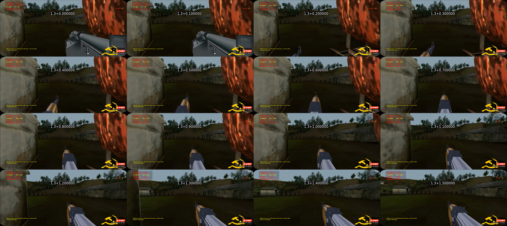
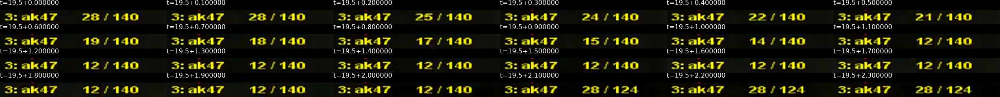
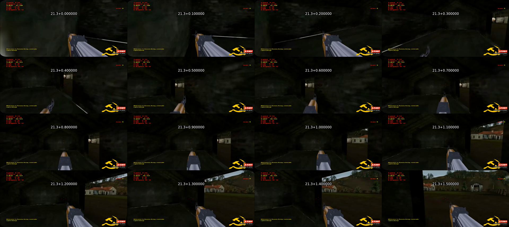

# Woodland animation observations

Reviewed on 2026-09-30 against the preserved first 45.1 seconds of [Saurogon's “Russias Army Woodland” video](https://www.youtube.com/watch?v=fkB8Yg9S1HM), uploaded 2014-09-02. The local [video](woodland-video-first45s.mp4) is 1280 × 574, 10 frames/second, with **no audio stream**. Retrieval and checksum are recorded in [source provenance](source-provenance.json). These observations address V25/V28 without claiming exact animation or gameplay replication.

The new sheets decode consecutive native video frames. Labels show the seek offset plus the frame's relative presentation time; each column advances 0.1 seconds, read left to right and top to bottom. Downscaling is for review only. Temporal resolution is 0.1 seconds; the recording may omit faster game frames, and input times are unknown.

| Visible event | Timestamp evidence | What it supports | What it does not establish |
| --- | --- | --- | --- |
| RG6 → AK47 selection and presentation | At 1.3–1.4 seconds the RG6 row is yellow and the bulky gray gun remains visible. At 1.5 seconds the AK47 row is yellow and its sight appears low at the bottom. The rifle rises from that low central position through 2.3 seconds and resembles its ordinary position at 2.4 seconds. | A pronounced lowered/raised equip presentation, occupying approximately 0.9 seconds of sampled footage. | Exact switch input time, attack lockout, equip duration for other weapons, or precise easing. |
| AK47 firing/ammunition sequence | The rifle row reads 28/140 at 19.5–19.6 seconds; 25/140 at 19.7; 24 at 19.8; 22 at 19.9; 21 at 20.0; 19 at 20.1; 18 at 20.2; 17 at 20.3; 15 at 20.4; 14 at 20.5; 12/140 at 20.6. | Sixteen displayed rounds are consumed during the sampled burst, with multiple rounds between some recorded frames. This is stronger evidence than guessing cadence from isolated stills. | Exact shot cadence, input onset/release, server update cadence, numerical damage or recoil magnitude. Do not derive a combat rate solely from these sampled counters. |
| AK47 ammunition refill and lowered/raised motion | 12/140 remains visible through 21.5 seconds. At 21.6 seconds it changes to 28/124 while the rifle is sharply lowered. It stays low around 21.7, rises through 22.3 and returns to the usual side framing around 22.4 seconds. | A refill associated with a simple gun-lower/gun-raise presentation; about 0.8 seconds from first clearly lowered sampled frame to ordinary framing. No separate animated magazine/hand exchange is resolved in these frames. | Reload keypress time or true reload lockout; whether this is automatic or manual; ammunition rules for all maps/builds. The footage's refill reaches 28, but one sequence alone should not redefine every weapon's capacity. |
| Woodland traversal | The player moves from exterior grass into timber and masonry buildings, then up hillside terrain during the excerpt. The camera continues turning/translating during equip/refill presentation. | Terrain-following traversal and continued camera motion while the presentation runs. | Original world-unit scale, run/walk speeds, jump apex, camera-height calibration, or movement keys held. |
| Rifle and environment effects | Firing occurs around 19.7–20.6 seconds near a bright window. The separate sharp [Mark Wiering still](woodland-mark-wiering.jpg) directly shows a large pale starburst around the rifle muzzle. | Pale bright muzzle-flash styling is visually evidenced. | Flash duration, light radius, projectile/tracer speed or lifetime. The 10 Hz silent clip cannot resolve brief flashes or supply firing, impact, reload, footstep or ambience audio. |

The source supports simplifying AK47 equip/refill presentation to a pronounced lowered/raised motion. It does not support claiming all six animations, timing, soldier gait/death pose or sound are matched. No clearly resolved opponent animation is present in this excerpt. Those requirements remain open.

The sheets were generated with FFmpeg from the preserved video, using input seeks `1.3`/`19.5`/`21.3`, lengths `1.6`/`2.4`/`1.6`, native frame rate, timestamp labels and `tile=4x4`/`6x4`/`4x4`. The burst sheet crops the rifle HUD at `crop=205:18:58:46`; the two presentation sheets retain the full frame and scale to 480 pixels wide per cell. The original video and existing frame artifacts were preserved.
