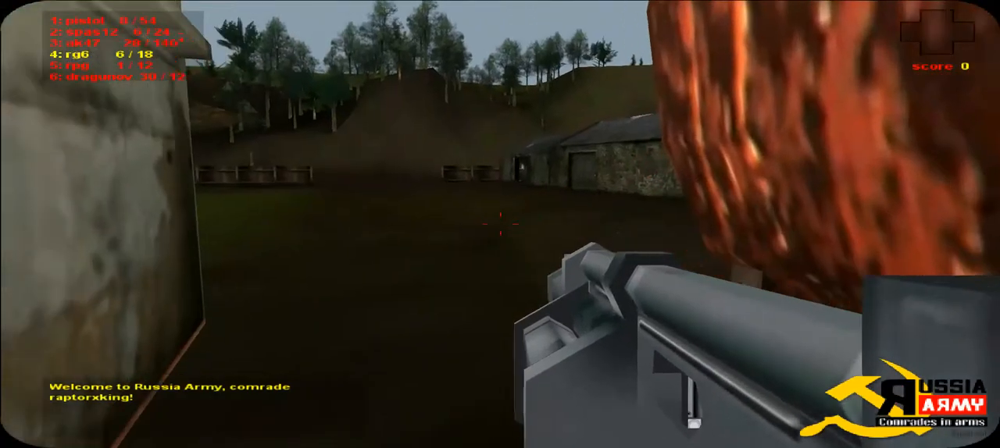

# RG6 visible presentation evidence

The [full decoded frame at 1.3 seconds](woodland-rg6-1.3.png) comes from the preserved [Woodland first-45-second video](woodland-video-first45s.mp4), sourced from [Saurogon's 2014-09-02 upload](https://www.youtube.com/watch?v=fkB8Yg9S1HM). See [source provenance](source-provenance.json) and [animation observations](ANIMATION_OBSERVATIONS.md). Extraction on 2026-09-30 used `ffmpeg -ss 1.3 -i woodland-video-first45s.mp4 -frames:v 1`; resolution is 1280 × 574. SHA-256: `dac6f3d1398ebbe68df112267cfabb32115a17f165a07037ce960b23efe1bb37`.

The yellow `4: rg6 6 / 18` HUD row identifies the selected weapon. A thick gray polygonal upper tube runs diagonally from its front cap toward the lower-right edge. Broad angular gray support/body faces fill the bottom right. Approximate visible front-cap position is 59% of frame width and 54% of height. The visible weapon's leftmost support begins around 51.5% width at 72% height. No exposed six-circle rear chamber cluster or player arm is resolved in this visible portion.

Frame 0 is an unusually large, elevated crop during preceding presentation/camera movement. The 1.3-second frame provides the more conservative composition target; it is not proof of exact original camera FOV, weapon dimensions or hidden RG6 geometry.

The copy's bounded legacy correction uses a broader eight-sided gray upper tube, angular front collar and flat support/rear body, keeps its movable drum lower in the composition, hides unsupported exposed chamber rings/player hands/tall fork sight, and adds slight side/top perspective. Rendered review exposed dark base-tint multiplication followed by overly flat light faces; explicit neutral gray variants and lighter upper/darker side face assignments correct those visible problems. Modern geometry and materials remain unchanged. The authoring dimensions, hip offset and perspective are screen-composition approximations. Neutral muzzle/sight/ejection/hand anchor positions are preserved; no ammunition, damage, firing, projectile or reload gameplay values are changed.

Matching this visible portion does not prove complete RG6 geometry, scope, reload animation, projectile effects or sound. Subsequent browser captures must assess framing and perceived colors, and original unseen portions remain unresolved.

